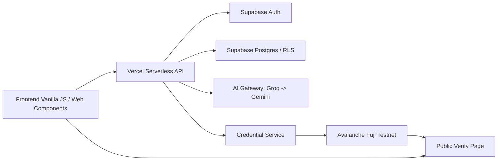
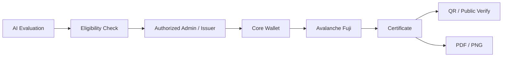

# PARADOX AI — EduDefend.OS

> **Sản phẩm dự thi UniHack 2026** · EduTech · AI Agents & Security
> Production: https://unihack2026-beryl.vercel.app/

PARADOX AI là trợ lý phản biện học tập của Nexus Academy Analytics. Thay vì đưa đáp án ngay, sản phẩm hướng người học tự rà soát lập luận, tìm lỗi, sửa bài và củng cố kiến thức bằng bài luyện tương tự.

Mục tiêu chính là giảm phụ thuộc vào AI trong học tập: AI đóng vai trò phản biện và hướng dẫn tư duy, còn người học vẫn là người đưa ra quyết định cuối cùng.

## Mục lục

1. [Tổng quan](#1-tổng-quan)
2. [Tính năng chính](#2-tính-năng-chính)
3. [Kiến trúc hệ thống](#3-kiến-trúc-hệ-thống)
4. [Technical Implementation](#4-technical-implementation)
5. [Avalanche Integration](#5-avalanche-integration)
6. [Verified On-chain Demo](#6-verified-on-chain-demo)
7. [Certificate Workflow](#7-certificate-workflow)
8. [Cài đặt và chạy local](#8-cài-đặt-và-chạy-local)
9. [Testing và CI/CD](#9-testing-và-cicd)
10. [Demo Guide cho Ban giám khảo](#10-demo-guide-cho-ban-giám-khảo)
11. [Giới hạn hiện tại và Roadmap](#11-giới-hạn-hiện-tại-và-roadmap)
12. [Cấu trúc repository](#12-cấu-trúc-repository)

---

## 1. Tổng quan

PARADOX AI kết hợp ba luồng học tập:

- **AI Audit**: phân tích bài làm, chỉ ra lỗi kiến thức/logic/phương pháp và đặt câu hỏi phản biện.
- **Practice Lab**: luyện tập củng cố kiến thức sau khi sửa lỗi.
- **Learning Passport**: theo dõi tiến độ, lịch sử học tập và chứng nhận Proof of Learning.

Sản phẩm được triển khai trên Vercel, dùng Supabase cho xác thực và dữ liệu người dùng, và Avalanche Fuji Testnet cho bằng chứng on-chain của chứng nhận.

## 2. Tính năng chính

- **AI Learning / AI Debate Engine**: nhận đề bài và lời giải, gọi AI Gateway phía server để đánh giá `correct`, `incorrect` hoặc `insufficient`, phân loại lỗi và hỗ trợ hỏi tiếp theo ngữ cảnh.
- **Learning Passport**: tổng hợp kỹ năng, đánh giá, chứng nhận và trạng thái xác minh on-chain.
- **Learning History và Analytics**: lưu phiên học, bản sửa, tương tác và phân tích 7/30/90 ngày.
- **Practice Lab**: câu hỏi trắc nghiệm, phản hồi đáp án và lưu trạng thái đã giải.
- **Certificate Center**: hiển thị chứng nhận đủ điều kiện, trạng thái phát hành, lịch sử phát hành và liên kết xác minh.
- **Admin Dashboard**: quản lý tài khoản, tìm kiếm, tạm khóa/mở khóa và phát hành chứng nhận cho issuer được ủy quyền.
- **Public Certificate Verification**: tra cứu chứng nhận theo mã, kiểm tra trạng thái on-chain, transaction hash và metadata integrity.
- **QR Code và xuất chứng nhận PDF/PNG**: tạo mã QR trỏ đến trang Verify công khai và xuất file chứng nhận.

Các chế độ ngôn ngữ được hỗ trợ: Tiếng Việt, English và Japanese. Giao diện hỗ trợ light/dark mode.

## 3. Kiến trúc hệ thống



Luồng chính:

`Frontend → Serverless API → AI Gateway / Supabase → Credential Service → Avalanche Fuji → Public Verify`

## 4. Technical Implementation

### Frontend

- HTML5, Vanilla JavaScript và Web Components.
- CSS thuần với các file `styles.css`, `editorial.css`, `views.css` và CSS theo từng khu vực.
- Điều hướng bằng hash: `#/audit`, `#/dashboard`, `#/passport`, `#/verify`, v.v.
- State và rendering được tổ chức trong `app.js`, `app-router.js`, `app-events.js` và `views/`.

### Backend

- Serverless functions trong thư mục `api/` trên Vercel.
- Supabase Auth và Supabase Postgres cho tài khoản, phiên học và chứng nhận.
- AI Gateway server-only trong `api/_ai/`, đọc key từ biến môi trường.
- Support widget dùng FAQ tĩnh, không gọi AI provider.

### Authentication và phân quyền

- Supabase Auth với cookie `HttpOnly`.
- Role admin được kiểm tra phía server.
- Route guard phía frontend và API.
- Admin endpoints như phát hành/thu hồi chứng nhận yêu cầu session admin hợp lệ.

### Validation và bảo mật

- Input được validate phía server trước khi gọi AI hoặc ghi database.
- Output AI được kiểm tra lại theo schema trước khi trả cho frontend.
- Learning record ownership được kiểm tra bằng `learner_id`.
- Credential API không tin dữ liệu do client khai báo cho trạng thái blockchain.
- Secret chỉ đặt ở server, không commit vào repository.

### Build và runtime

- `npm run build` tạo static site trong thư mục `build/`.
- `vercel.json` khai báo `"outputDirectory": "build"`.
- Build script copy các file tĩnh, asset, font, vendor và bỏ source map của esbuild.

### Kiểm thử

- Playwright end-to-end cho UI, accessibility, auth, practice, passport, certificate và verification.
- Hardhat/Solidity tests cho smart contract.
- GitHub Actions chạy Playwright và audit Lighthouse.

## 5. Avalanche Integration

PARADOX AI dùng Avalanche Fuji Testnet để lưu bằng chứng Proof of Learning dưới dạng hash, không lưu PII trên chain.

### Mạng và contract

- Network: **Avalanche Fuji Testnet**
- Chain ID: **43113** (`0xa869`)
- Contract: `LearningCredentialRegistry`
- Contract address: `0xa0c69eE573cdA8d1d08B46f81AbfA0A15A45CF2b`
- Explorer: https://explorer-test.avax.network/c-chain

### Smart contract

`LearningCredentialRegistry` chỉ lưu:

- `bytes32 credentialId`
- `bytes32 evidenceHash`
- địa chỉ issuer
- timestamp phát hành/thu hồi

Contract hỗ trợ:

- Owner cấp hoặc thu hồi quyền issuer.
- Owner luôn phải còn quyền issuer.
- Chỉ issuer được ủy quyền mới được phát hành/thu hồi.
- Chặn credential ID trùng, evidence hash trùng, hash rỗng và thu hồi lần hai.
- Xác minh tồn tại/trạng thái qua `credentialExists`, `getCredential`, `isCredentialValid`.
- Chuyển owner hai bước: `transferOwnership` / `acceptOwnership`.

### Quy trình phát hành

1. Backend kiểm tra eligibility của evaluation.
2. Admin/issuer được ủy quyền chuẩn bị issuance.
3. Core Wallet kiểm tra mạng Fuji `43113`.
4. Người dùng ký transaction bằng Core Wallet.
5. Backend hòa giải transaction hash và xác minh on-chain.
6. Supabase lưu metadata off-chain và trạng thái xác minh.
7. QR và Public Verify chỉ hiển thị cho credential đã verified.

### Vai trò của blockchain so với Supabase

- **Supabase** lưu metadata off-chain, trạng thái, lịch sử transaction và dữ liệu người học.
- **Avalanche Fuji** lưu credential ID hash, evidence hash, issuer và timestamp để kiểm chứng độc lập.
- Frontend không nhận private key.
- Public Verify so sánh evidence hash on-chain với database trước khi trả trạng thái.

### Revocation

Contract hỗ trợ `revokeCredential`. Backend giới hạn revoke cho issuer phù hợp và không cho credential revoked được khôi phục thành confirmed.

## 6. Verified On-chain Demo

Ví dụ chứng nhận đã phát hành:

| Trường | Giá trị |
| --- | --- |
| Certificate ID | `PXP-MATH-001` |
| Network | Avalanche Fuji Testnet |
| Chain ID | `43113` |
| Transaction hash | `0xa12145309d1d8cc3fb094a7e51793c37437577caa9c01556fc9c62d61ed77ec3` |
| Public Verify | https://unihack2026-beryl.vercel.app/verify?code=PXP-MATH-001 |
| Certificate validity | VALID |
| Transaction verification | VERIFIED |
| Metadata integrity | UNVERIFIED |

Trạng thái này được ghi nhận minh bạch: giao dịch và credential on-chain được xác minh, nhưng metadata attestation của chứng nhận này chưa được chứng thực toàn vẹn.

## 7. Certificate Workflow



Có hai luồng chứng nhận tách biệt:

- **AI Evaluation Certificate**: cấp từ AI evaluation đủ điều kiện, score >= 80 và proof record hợp lệ. Chỉ Admin/issuer được ủy quyền mới phát hành.
- **Competency Certificate**: cấp từ competency assessment đã passed, có giải thích độc lập, score >= 60 và đúng rubric/bank version.

Hai luồng này không dùng chung điều kiện cấp.

## 8. Cài đặt và chạy local

### Yêu cầu

- Node.js >= 22.12
- npm
- Chromium cho Playwright

### Cài đặt

```bash
npm install
npx playwright install chromium
```

### Cấu hình môi trường

Sao chép `.env.example` thành `.env` và cấu hình các biến cần thiết:

```env
SUPABASE_URL=https://your-project.supabase.co
SUPABASE_ANON_KEY=your-anon-key
SUPABASE_SERVICE_ROLE_KEY=your-service-role-key
ADMIN_EMAILS=admin@paradox.ai
OTP_SECRET=mot-chuoi-bi-mat-ngau-nhien-toi-thieu-32-ky-tu

GROQ_API_KEY=your-groq-key
GEMINI_API_KEY=your-gemini-key

AVALANCHE_FUJI_RPC_URL=https://api.avax-test.network/ext/bc/C/rpc
AVALANCHE_CREDENTIAL_REGISTRY_ADDRESS=0xa0c69eE573cdA8d1d08B46f81AbfA0A15A45CF2b
```

Không commit `.env` hoặc các secret.

### Chạy ứng dụng

```bash
npm run build
npm run serve
```

Truy cập `http://127.0.0.1:8173`. Nếu `.env` có cấu hình email, bản demo gửi OTP thật; nếu chưa, mã OTP local được hiển thị trong hộp thoại để phát triển.

### Lệnh hữu ích

```bash
npm run build
npm run serve
npm run contract:test
npm test
npm run test:all
```

## 9. Testing và CI/CD

- `.github/workflows/test.yml` chạy Playwright cho pull request/push.
- Lighthouse CI audit bản static theo các ngưỡng đã cấu hình.
- Hardhat tests kiểm tra smart contract.
- Playwright tests bao phủ auth, Practice, Learning Passport, certificate, public verify, transaction verification, metadata attestation và UI.

Kết quả xác minh gần nhất:

- Local full suite: **528 passed, 12 skipped**.
- CI cho PR #21: Lighthouse, Database và Playwright **success**.

## 10. Demo Guide cho Ban giám khảo

1. Truy cập Production: https://unihack2026-beryl.vercel.app/
2. Thử AI Learning / AI Audit tại `#/audit`.
3. Xem Learning Passport tại `#/passport`.
4. Kiểm tra Certificate Center và danh sách chứng nhận.
5. Mở Public Verify: https://unihack2026-beryl.vercel.app/verify?code=PXP-MATH-001
6. Kiểm tra transaction trên Avalanche Explorer:
   https://explorer-test.avax.network/c-chain/tx/0xa12145309d1d8cc3fb094a7e51793c37437577caa9c01556fc9c62d61ed77ec3
7. Nếu có phiên học viên/issuer, xem Certificate Center và xuất PDF/PNG.

Phân biệt thao tác công khai với thao tác cần tài khoản học viên hoặc quyền Admin.

## 11. Giới hạn hiện tại và Roadmap

- Production đang dùng Avalanche Fuji Testnet, không phải Mainnet.
- Metadata attestation của `PXP-MATH-001` hiện là **UNVERIFIED**.
- Practice Lab và Avatar phụ thuộc migration Supabase; nếu migration chưa được áp dụng, giao diện hiển thị fallback an toàn.
- Preview deployment và một số gate vận hành chưa được xác minh đầy đủ.
- Chưa có bằng chứng live issuance mới cho mọi credential.
- Hướng phát triển tiếp theo:
  - Hoàn thiện metadata attestation.
  - Xác minh live issuance và QR end-to-end.
  - Cải thiện visual regression cho certificate.
  - Tối ưu performance và accessibility.

## 12. Cấu trúc repository

| Đường dẫn | Vai trò |
| --- | --- |
| `index.html` | Điểm vào ứng dụng, font, CSP và stylesheet |
| `app.js`, `app-router.js`, `app-events.js` | Web Component gốc, routing và event delegation |
| `views/` | Template theo khu vực: dashboard, audit, passport, admin, practice, v.v. |
| `certificate-renderer.js` | Render certificate, export PNG/PDF và QR |
| `certificate-issuance-actions.js` | Luồng prepare, ký và confirm issuance |
| `learning-passport-service.js` | Client service cho Passport và credential API |
| `api/auth/` | OTP, session, avatar và profile |
| `api/credentials/` | Credential API, Fuji gateway, public verify và QR |
| `api/learning-records/` | Learning sessions, submissions, evaluations |
| `api/practice/` | Practice Lab API và store |
| `api/_ai/` | AI Gateway server-only |
| `contracts/` | Solidity contract và tests |
| `supabase/migrations/` | Migration credential, learning records, practice, avatar |
| `scripts/build-frontend.cjs` | Build static site cho Vercel |
| `tests/` | Playwright, contract và regression tests |
| `vercel.json` | Output directory và rewrite/header |
| `docs/` | Tài liệu kỹ thuật và báo cáo |

## Liên kết

- Production: https://unihack2026-beryl.vercel.app/
- Public Verify: https://unihack2026-beryl.vercel.app/verify?code=PXP-MATH-001
- Repository: https://github.com/hiza325/UNIHACK2026
- Contract: https://explorer-test.avax.network/c-chain/address/0xa0c69eE573cdA8d1d08B46f81AbfA0A15A45CF2b
- Transaction: https://explorer-test.avax.network/c-chain/tx/0xa12145309d1d8cc3fb094a7e51793c37437577caa9c01556fc9c62d61ed77ec3
EOF