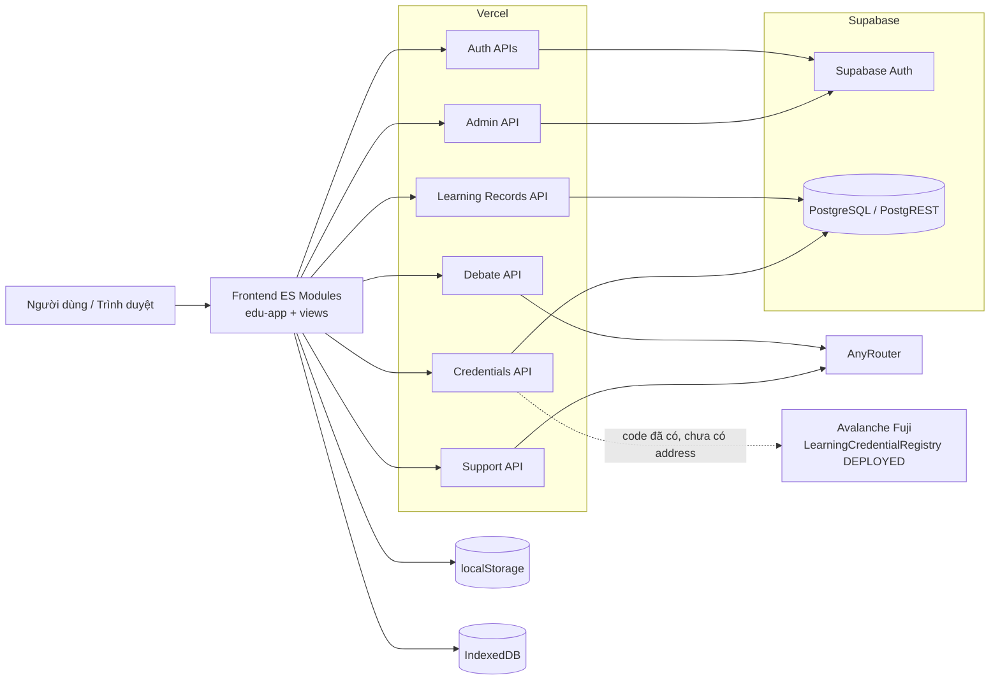
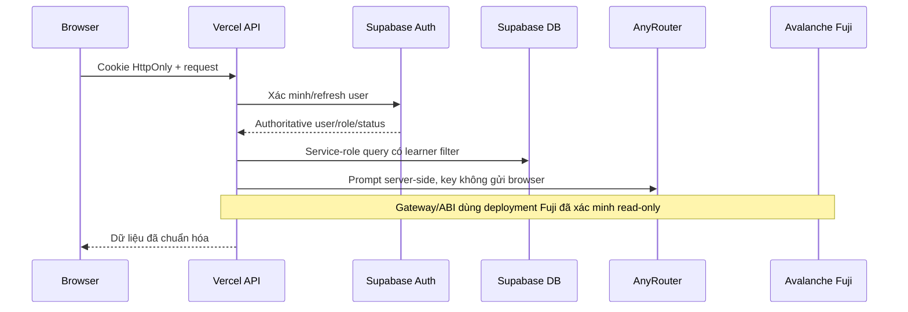

# PARADOX AI — Kiểm kê hệ thống Giai đoạn 0

**Ngày kiểm kê:** 2026-10-28  
**Commit được kiểm tra:** `e6d126c`  
**Nhánh:** `main`  
**Phạm vi:** repository local, cấu hình local theo tên biến (không đọc giá trị vào báo cáo), kiểm tra HTTP chỉ đọc trên Vercel, kiểm tra schema Supabase bằng `HEAD`, test local. Không ghi dữ liệu production và không gửi giao dịch blockchain.

## 1. Kiến trúc thực tế

- **Frontend:** HTML5, CSS thuần, ES modules, Vanilla JavaScript và một Web Component gốc `<edu-app>`. Không có framework SPA và không có bước bundle frontend.
- **Routing:** hash routing trong `app-router.js`.
- **Backend:** 12 Vercel Node.js Serverless Functions trong `api/`; helper có tiền tố `_` không phải function độc lập.
- **Authentication/database:** Supabase Auth + Supabase PostgreSQL/PostgREST. Phiên remote dùng access/refresh cookie `HttpOnly`, `Secure`, `SameSite=Strict`.
- **AI:** proxy server-side tới AnyRouter Chat Completions, model mặc định `anyrouter/free`. Không có Gemini SDK hoặc endpoint Gemini trong repository.
- **Blockchain:** Solidity 0.8.28, Hardhat 3, Ethers v6; code chỉ chấp nhận Avalanche Fuji chain ID `43113`. Cập nhật sau audit: deployment đã được xác minh tại `0xa0c69eE573cdA8d1d08B46f81AbfA0A15A45CF2b`; xem `docs/CHAIN-01-REPORT.md`.
- **Lưu trữ trình duyệt:** `localStorage` cho tài khoản demo, settings, practice và history fallback; IndexedDB `paradox-learning/state` cho state AI Audit.
- **File:** người dùng chỉ chọn file và lưu metadata/tên file trong state; byte file không được upload hay gửi vào AI.

### 1.1 Sơ đồ thành phần

### 1.2 Luồng trust boundary

## 2. Frontend

### 2.1 Trang và route

| Route | View/file | Mô tả | Nguồn dữ liệu hiện tại |
|---|---|---|---|
| Landing | `views/landing.js` | Giới thiệu, đăng ký, đăng nhập, OTP, quên mật khẩu, kháng cáo khóa | Supabase khi cấu hình; fallback local ở development |
| `#/dashboard` | `views/dashboard.js` | Tổng quan tiến độ | Learning Records nếu remote; local history fallback |
| `#/audit` | `views/audit.js` | AI Audit/Debate, hint, discuss, resubmit | `/api/debate`; learning records nếu remote |
| `#/history` | `views/history.js` | Danh sách, tìm kiếm, lọc, phân trang, import/export | Supabase hoặc localStorage |
| `#/analytics` | `views/analytics.js` | Chỉ số và biểu đồ 7/30/90 ngày | Tính từ history/practice hiện có |
| `#/practice` | `views/practice.js` | Trắc nghiệm và phản hồi | Fixtures trong `demo.js` |
| `#/profile` | `views/profile.js` | Hồ sơ và đổi tên hiển thị | Trình duyệt; không đồng bộ tên remote về Supabase |
| `#/passport` | `views/passport.js` | Hồ sơ kỹ năng/chứng nhận | Mock local hoặc `/api/credentials` với remote session |
| `#/verify` | `views/passport.js` | Tra cứu/xác minh credential | Mock local hoặc POST `/api/credentials` |
| `#/about` | `views/about.js` | Hướng dẫn/giới thiệu | Static |
| `#/settings` | `views/settings.js` | Theme, ngôn ngữ, môn, hint, thông báo | localStorage |
| `#/admin` | `views/admin.js` | Người dùng, khóa/mở khóa, lý do, kháng cáo | `/api/admin/users`; local fallback |
| `#/sitemap` | `views/sitemap.js` | Sitemap công khai | Static |

Route ngoại trừ sitemap/landing được bảo vệ ở frontend; quyền thực sự cho admin và dữ liệu nhạy cảm được kiểm tra lại ở API.

### 2.2 Component và module chính

- `app.js`: custom element gốc, state và lifecycle.
- `components.js`: đăng ký `<edu-app>`, `<audit-stepper>`, `<audit-message>`; hai component sau hiện chỉ là custom element rỗng, phần hiển thị nằm trong view templates.
- `app-actions.js`, `app-events.js`, `app-router.js`, `app-data.js`, `app-theme.js`: controller/state/event/router/storage.
- `views/*.js`: template theo màn hình.
- `debate-ai.js`: client AI Debate, deduplicate và cache ngắn hạn.
- `learning-records-service.js`, `learning-records-actions.js`: client đồng bộ session học.
- `learning-passport-service.js`, `learning-passport-actions.js`: client Passport/credential.
- `support-ai.js`: client widget trợ lý sử dụng website.
- `demo.js`, `learning-passport-mock.js`: fixtures được xác định rõ là demo/mock.

### 2.3 API frontend gọi

- `/api/auth/signup`, `/login`, `/verify`, `/resend`, `/otp`, `/session`, `/logout`
- `/api/admin/users`
- `/api/debate`
- `/api/support`
- `/api/learning-records`
- `/api/credentials`

## 3. Backend

### 3.1 Danh sách endpoint

| Endpoint | Method | Bảo vệ | Chức năng |
|---|---|---|---|
| `/api/auth/signup` | POST | Public + rate limit OTP | Tạo user pending/Supabase signup và gửi OTP |
| `/api/auth/login` | POST | Public | Password login, tạo cookie; trả lý do/token kháng cáo nếu bị khóa |
| `/api/auth/verify` | POST | Public + rate limit | Xác minh OTP, confirm user, tạo session |
| `/api/auth/resend` | POST | Public + rate limit | Gửi lại OTP |
| `/api/auth/otp` | POST | Public + rate limit | OTP chung, password reset và suspension appeal |
| `/api/auth/session` | GET | Session | Khôi phục/refresh phiên và kiểm tra trạng thái khóa authoritative |
| `/api/auth/logout` | POST | Session | Logout Supabase và xóa cookie |
| `/api/admin/users` | GET/PATCH | Admin | Liệt kê, khóa/mở khóa, lý do và appeal metadata |
| `/api/debate` | POST | Không bắt buộc session; session bắt buộc khi có learning-record context | AnyRouter AI Audit và ghi kết quả đã validate |
| `/api/support` | POST | Public | AnyRouter trợ lý sử dụng website |
| `/api/learning-records` | GET/POST | Session | CRUD có giới hạn cho phiên học/submission/history |
| `/api/credentials` | GET/POST | Session; issue/revoke cần admin | Passport, issue/verify/revoke Fuji credential |

### 3.2 Authentication và authorization

- Supabase Auth là nguồn tài khoản remote. `app_metadata.role=admin` hoặc email nằm trong `ADMIN_EMAILS` tạo quyền admin.
- `currentUser()` xác minh token với Supabase, refresh khi access token hết hạn, rồi dùng service role đọc authoritative user để phát hiện ban.
- `requireAdmin()` kiểm tra role ở server.
- Learning Records luôn lấy `learner_id` từ session; store thêm filter `learner_id` vào read/update.
- Credential issue/revoke yêu cầu admin; Passport list theo learner hiện tại.
- Local development có auth fallback trong trình duyệt bằng PBKDF2 và danh sách admin hardcode; không phải cơ chế production.

### 3.3 Validation, lỗi và middleware

- Không có framework middleware chung; mỗi handler tự kiểm tra method, parse body, validation và mapping lỗi.
- Input AI bị giới hạn độ dài; output AnyRouter được parse JSON và kiểm tra status/category/rubric ở server.
- OTP challenge và appeal token dùng HMAC; so sánh chữ ký bằng `timingSafeEqual`.
- Rate limit OTP và Debate là in-memory theo serverless instance.
- Cookie có `HttpOnly`, `Secure`, `SameSite=Strict`; không có CSRF token hoặc Origin-check riêng.
- CORS API không chủ động mở cross-origin; static Vercel trả `Access-Control-Allow-Origin: *`.

### 3.4 AI Audit

- Provider thực tế trong code là **AnyRouter**, không phải Gemini.
- Modes: `analyze`, `discuss`, `hint`, `resubmit`.
- Timeout 25 giây, tối đa 15 request/phút/IP/instance, output schema validation và rubric 4 tiêu chí.
- Proof record là SHA-256 off-chain; không tự phát hành credential.
- Local `.env` không có `ANYROUTER_API_KEY`/`ANYROUTER_MODEL`; test dùng mock fetch. Live inference không được gọi trong kiểm kê để tránh tiêu tốn dịch vụ production.

## 4. Database và storage

### 4.1 Supabase

Kiểm tra read-only `HEAD` trả `200` cho cả 6 bảng trên project local ban đầu. Sau khi có approval, đúng hai migration cùng commit `e6d126c` được xác minh SHA-256 và chạy thành công trên Supabase staging; 6/6 bảng staging cũng trả `200`:

| Bảng | Quan hệ chính | Dữ liệu |
|---|---|---|
| `learning_sessions` | `learner_id -> auth.users` | Đề bài, subject, trạng thái, thời lượng |
| `learning_submissions` | `session_id -> learning_sessions`, `learner_id -> auth.users` | Bài nộp/bản sửa, output AI |
| `learning_interactions` | session/submission/user | Analysis, discussion, hint |
| `learning_evaluations` | session/submission/user | Rubric, proof record, eligibility |
| `learning_credentials` | `learner_id`, `created_by -> auth.users` | Metadata credential và trạng thái Fuji |
| `credential_transactions` | `credential_id -> learning_credentials` | Lịch sử issue/revoke transaction |

RLS cho Learning Records chỉ cho authenticated đọc bản ghi của chính mình; quyền ghi chỉ dành cho service role. Credential tables không cấp quyền cho anon/authenticated và chỉ service role truy cập.

### 4.2 Tài khoản và dữ liệu trình duyệt

- Tài khoản remote và password hash: Supabase Auth.
- Role, lý do khóa, appeal: Supabase Auth `app_metadata`.
- Remote learning history: Supabase sau khi đăng nhập.
- Practice/settings và auth demo: localStorage.
- Audit working state: IndexedDB.
- Mock content: `demo.js`, `learning-passport-mock.js`.

### 4.3 File upload

- Client kiểm tra extension và giới hạn 10 MiB.
- Không có upload backend, Supabase Storage bucket, virus scan, MIME sniffing hay object-level authorization.
- File content không được gửi tới AI; chỉ metadata/tên file được lưu trong audit state.

## 5. Avalanche Integration

### 5.1 Thành phần có trong repository

- `ethers@6.17.0`, `hardhat@3.21.1`.
- Contract `LearningCredentialRegistry.sol` với issuer allowlist, issue, verify, revoke và two-step ownership transfer.
- ABI tối thiểu trong `api/credentials/_avalanche.js` và artifact Hardhat.
- Chain guard bắt buộc Fuji `43113`.
- Gateway read/write, receipt handling, error mapping, retry/reconciliation logic.
- Deploy script kiểm tra chain ID, balance, receipt và authorization trước khi ghi manifest.
- 8/8 Solidity tests pass; credential service tests pass bằng mock gateway/store.

### 5.2 Tình trạng triển khai thực tế

- Có manifest công khai tại `deployments/avalanche-fuji.json`; không chứa private key.
- `.env` local không có ba biến Avalanche.
- Không có contract address có thể kiểm tra bytecode.
- Không có transaction hash thật được kiểm tra trong audit.
- Không gửi RPC write hoặc transaction theo yêu cầu.

**Kết luận:** smart contract và integration layer đã được triển khai ở mức code/test local, nhưng **Avalanche deployment/integration thực tế: CHƯA TRIỂN KHAI**.

## 6. Bảng phân loại chức năng

| Chức năng | File liên quan | Trạng thái | Bằng chứng | Vấn đề | Đề xuất |
|---|---|---|---|---|---|
| Landing, responsive, theme, i18n | `views/landing.js`, `app-theme.js`, `i18n.js` | WORKING | Playwright/axe pass | Không có lỗi blocker trong test | Giữ regression test |
| Hash routing và route guard | `app-router.js`, `demo.js` | WORKING | Route guard tests pass | Guard frontend không thay thế API auth | Duy trì API authorization |
| Auth local demo | `app-data.js`, `app-actions.js` | WORKING | Signup/login/logout Playwright pass | Dữ liệu chỉ ở browser | Chỉ dùng development |
| Supabase remote auth/session | `api/auth/*` | PARTIAL | Production endpoints trả 401 đúng; Supabase/Auth read-only reachable; unit tests pass | Không thực hiện login/signup production trong audit | E2E trên staging riêng |
| OTP email | `_mail.js`, `otp.js`, `signup.js` | UNVERIFIED | SMTP/Gmail mocked tests pass; biến Gmail tồn tại local | Không gửi mail thật trong audit | Test mailbox staging |
| Password reset | `_password-reset.js`, `otp.js` | UNVERIFIED | Unit/UI mocked tests pass | Chưa E2E mail staging | Kiểm thử staging không dùng user thật |
| Admin users/role | `api/admin/users.js`, `views/admin.js` | PARTIAL | Server authorization tests; project có admin | Không có bộ Student A/B chuẩn | Tạo fixtures staging |
| Ban, revoke session, appeal | `_supabase.js`, `_suspension.js`, `admin/users.js` | PARTIAL | API/UI tests pass | Audit không thay đổi account production | E2E staging nhiều phiên |
| AI Audit UI | `views/audit.js`, `app-actions.js`, `debate-ai.js` | PARTIAL | UI tests pass với mocked API | Provider live chưa kiểm chứng; local thiếu key | Cấu hình key staging và test deterministic cases |
| AI Audit backend/rubric | `api/debate.js`, `debate-prompt.js` | PARTIAL | Validation/rate-limit/proof tests pass | Endpoint AI không bắt buộc auth; limit per instance | Require session và shared limiter |
| Support AI | `api/support.js`, `support-ai.js` | UNVERIFIED | Mocked API test pass | Public, không rate limit; local thiếu key | Auth/rate limit và staging smoke test |
| Learning Records schema/API | `api/learning-records/*`, migration `...0002...sql` | WORKING | 4 bảng staging reachable; Student A tạo/đọc session; Student B đọc/sửa nhận `404`; RLS cho A thấy 1 hàng, B thấy 0 | Session nghiệm thu được giữ ở trạng thái `abandoned` để truy vết | Duy trì regression E2E và retention policy |
| Dashboard/History remote | `learning-records-actions.js`, views | PARTIAL | Client persistence/history tests pass | Chưa chứng minh dữ liệu production thực | Test against staging DB |
| Practice Lab | `demo.js`, `views/practice.js` | MOCK | Fixtures rõ ràng; UI test pass | Nội dung và đáp án hardcode | Gắn nhãn demo hoặc tạo content service |
| Analytics | `views/analytics.js`, `app-data.js` | PARTIAL | Tính từ session/practice; view tests pass | Practice vẫn local/mock | Xác định metric production |
| Profile/settings | `views/profile.js`, `views/settings.js` | PARTIAL | UI/local persistence hoạt động | Profile remote không cập nhật Supabase | Thêm API profile nếu cần đa thiết bị |
| Learning Passport local | `learning-passport-mock.js` | MOCK | Mock được gắn nhãn và test | Không phải bằng chứng blockchain | Không dùng mock khi chấm Avalanche |
| Credential DB/API | `api/credentials/*`, migration `...0001...sql` | PARTIAL | 2 tables reachable; service tests pass | Không có chain deployment | Chỉ bật issue sau deploy/staging verification |
| Smart contract local | `contracts/*.sol`, `hardhat.config.ts` | WORKING | 8/8 Solidity tests pass | Chưa audit độc lập | Thêm coverage/fuzz/property review |
| Fuji deployment | deploy script, `_avalanche.js` | NOT_IMPLEMENTED | Không manifest/address/env local | Không thể kiểm bytecode/ABI on-chain | Deploy Fuji theo change approval riêng |
| On-chain issue/revoke/verify | credential service/gateway | NOT_IMPLEMENTED | Chỉ mock gateway tests | Không contract/tx thật | E2E Fuji sau deploy |
| File upload/phân tích file | `app-actions.js`, `app-config.js` | MOCK | Client chỉ giữ metadata | Không upload, scan hoặc parse | Hoặc ghi rõ chưa hỗ trợ, hoặc thiết kế Storage an toàn |
| Import/export JSON | `app-data.js` | UNVERIFIED | Có code và validation cơ bản | Không có test chuyên biệt | Thêm test malformed/large file |
| Notification | `app-notifications.js` | WORKING | Playwright pass | Phụ thuộc browser permission | Giữ fallback UX |

## 7. Ma trận nguồn dữ liệu thật và dữ liệu mẫu

| Khu vực | Chế độ remote | Chế độ local/demo | Nhãn/kết luận bắt buộc |
|---|---|---|---|
| Tài khoản | Supabase Auth — **THẬT** | localStorage/PBKDF2 — **DEMO** | Không dùng local account làm bằng chứng production |
| OTP | SMTP/Gmail/Resend — **THẬT khi cấu hình** | OTP hiện trên màn hình — **DEMO** | `developmentCode` không được trả ở Vercel |
| AI Audit | AnyRouter — **THẬT khi key hoạt động** | Không có AI fallback hợp lệ | Test mock không chứng minh live inference |
| Learning Records | Supabase tables — **THẬT** | localStorage/IndexedDB — **LOCAL** | History local không phải dữ liệu đa thiết bị |
| Practice | Không có remote content service | `demo.js` — **MOCK** | Không dùng điểm Practice làm bằng chứng AI/Avalanche |
| Analytics | Tính từ Learning Records nếu remote | Tính từ local/mock activity | Phải nêu nguồn session khi trình diễn |
| Learning Passport | `/api/credentials` — chỉ thật khi có credential on-chain đã verify | `learning-passport-mock.js` — **MOCK DATA** | UI Passport đã có badge mock |
| Credential | Supabase metadata + Fuji receipt — **CHƯA CÓ DỮ LIỆU THẬT** | Mock fixtures/test gateway | Không gọi trạng thái `verified` nếu thiếu chain verification |
| File upload | Không có | Chỉ metadata client — **MÔ PHỎNG** | Không tuyên bố file đã được upload/phân tích |

Quy ước nghiệm thu: code path, unit test hoặc fixture không được xem là triển khai thật. Chỉ dữ liệu từ dịch vụ đã cấu hình và được E2E xác minh mới được ghi là **THẬT**.

## 8. Bộ tài khoản thử yêu cầu cho staging

| Alias | Role mong đợi | Dữ liệu sở hữu | Kiểm thử bắt buộc | Trạng thái provisioning |
|---|---|---|---|---|
| Student A | `user` | Session/credential riêng A | Tạo/đọc dữ liệu A; không đọc B; không vào Admin | PROVISIONED — đăng nhập và role đã xác minh trên Supabase staging |
| Student B | `user` | Session/credential riêng B | Tạo/đọc dữ liệu B; không đọc A; không vào Admin | PROVISIONED — đăng nhập và role đã xác minh trên Supabase staging |
| Admin | `admin` trong `app_metadata` | Quản trị staging | List/ban/unban/review appeal; issue test credential sau Fuji deploy | PROVISIONED — đăng nhập và role đã xác minh trên Supabase staging |

Không lưu password trong Git hoặc báo cáo. Credential phải được phát qua secret manager của nhóm và bắt buộc đổi/xóa sau nghiệm thu. Không dùng allowlist email production làm bộ tài khoản staging.

Vercel/Supabase staging đã tách riêng. Admin guard E2E đạt (Student A/B nhận `403`, Admin nhận `200`); cross-user API và RLS ownership đều đạt. Một session nghiệm thu có nhãn Phase 0 được tạo trên staging và sau kiểm thử được chuyển sang `abandoned`.

## 9. Bằng chứng kiểm thử

- `npm test`: **65/65 pass**.
- `npm run contract:test`: **8/8 pass**.
- `npm run contract:build`: thành công, cache báo không cần compile lại.
- GitHub Actions run `40687693284` của đúng commit `e6d126c`: **success** trên runner Ubuntu sạch; workflow chạy `npm ci`, contract tests và Playwright.
- Production read-only: `/` và `/app.js` trả 200; API protected trả 401 khi không có session.
- Supabase read-only: 6/6 bảng trả 200.
- Không có live AI call, production database write hoặc Avalanche RPC write. Database write và hai migration chỉ thực hiện trên staging sau khi được phê duyệt.
